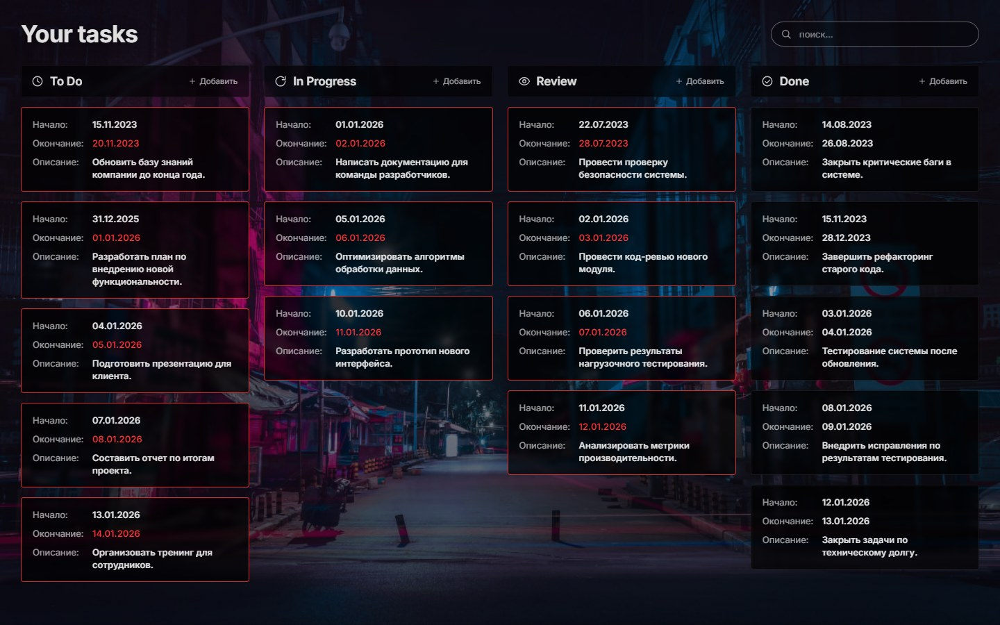

# Kanban-доска «Your tasks»

Тестовое задание для IP: канбан-доска с задачами из JSON, сортировкой, поиском,
редактированием, drag&drop и сохранением состояния в `localStorage`.

**Деплой:** https://mag1c54.github.io/ip-kanban-test-task/  
**Репозиторий:** https://github.com/Mag1c54/ip-kanban-test-task

[](https://mag1c54.github.io/ip-kanban-test-task/)

## Стек

- React 18 + TypeScript
- webpack 5 + webpack-dev-server
- Jest + ts-jest
- CSS без UI-библиотек
- Шрифт Inter подключён локально (без внешних CDN)

Проект рассчитан на Node.js 18.18.0+ (`engines` в `package.json`).

## Запуск

```bash
npm install
npm run start
```

Дев-сервер откроется на [http://localhost:3000](http://localhost:3000).

### Скрипты

| Команда | Что делает |
| --- | --- |
| `npm run start` | Запускает webpack dev server на порту 3000 |
| `npm run build` | Собирает production-версию в `dist/` |
| `npm run test` | Запускает unit-тесты Jest |
| `npm run test:watch` | Запускает тесты в watch-режиме |
| `npm run typecheck` | Проверяет типы через `tsc --noEmit` |
| `npm run deploy` | Собирает проект и публикует `dist/` в ветку `gh-pages` |

## Unit-тесты

Функция проверки просроченной задачи:
`src/features/kanban/lib/isTaskOverdue.ts`.

**Path до файла с unit-тестом функции:**

```text
src/features/kanban/lib/__tests__/isTaskOverdue.test.ts
```

Запуск:

```bash
npm run test
```

Тест проверяет дедлайн в прошлом, дедлайн сегодня, будущий дедлайн, статус
`done` и сравнение именно календарных дней (а не точного времени).

Дополнительно покрыты чистые функции: фильтрация и группировка задач,
reducer мутаций доски, валидация формы и загрузка/сохранение в `localStorage`.
Все тесты лежат рядом с кодом в `src/features/kanban/lib/__tests__/`.

## Реализовано

### Обязательные требования

- Задачи рендерятся в 4 колонки по статусу: To Do, In Progress, Review, Done.
- Внутри каждой колонки задачи отсортированы по `startDay` по возрастанию.
- Просроченные задачи (`endDay` раньше сегодняшнего дня) имеют красную обводку
  и красную дату окончания. Задачи в статусе `done` просроченными не считаются.
- Удаление поштучно: иконка корзины появляется при наведении на карточку.
- Адаптивность:
  - при ширине экрана от 768px доска занимает всю доступную ширину;
  - при ширине меньше 768px появляется горизонтальный скролл;
  - контент ограничен шириной 1920px и центрируется с отступами по бокам на
    больших экранах.

### Дополнительные требования

- Редактирование задачи: даты начала/окончания и описание.
- Добавление новой задачи в любую колонку.
- Drag&drop задач между колонками.
- Состояние доски сохраняется в `localStorage` с ключом
  `ip-kanban.tasks.v1` и не теряется после перезагрузки.
- Если в `localStorage` нет сохранённой доски, загружаются задачи из
  `src/features/kanban/data/tasks.json`.
- Поиск:
  - обычный текст ищется по описанию без учёта регистра;
  - дата в формате `dd.mm.yyyy` ищет совпадение по `startDay` или `endDay`.
- Unit-тест функции определения просрочки, запуск через `npm run test`.

## Особенности реализации

- Просрочка определяется по локальным календарным дням: задача с дедлайном
  «сегодня» не становится просроченной до конца текущего дня.
- После изменения даты начала задача автоматически пересортировывается.
- Пустой массив, сохранённый в `localStorage`, считается осознанным состоянием:
  если пользователь удалил все задачи, после обновления доска останется пустой.
  Демо-данные подставляются только при отсутствии сохранённого значения.
- Даты в форме редактирования и в поиске вводятся в формате `dd.mm.yyyy`;
  в форме ввода разделители подставляются автоматически.
- На устройствах без hover (touch) кнопки действий всегда видимы.
- Иконки, кнопки и поля имеют состояния hover/focus/active, предусмотрены
  `aria-label`, `aria-live` и навигация с клавиатуры.

## Архитектура

- `src/app/App.tsx` — только композиция страницы, без бизнес-логики.
- `useKanbanBoard` владеет состоянием доски, drag&drop и сохранением.
- Все мутации задач проходят через чистый `boardReducer` и покрыты тестами.
- Компоненты получают данные и набор действий через props и не знают
  о `localStorage`.
- Поиск, валидация формы, сортировка и определение просрочки вынесены
  в независимые функции в `lib/`.

## Структура проекта

Проект разбит по фичам: состояние доски, UI канбана и переиспользуемые
примитивы не зависят друг от друга через общий `App.tsx`.

```text
src/
  app/
    App.tsx                    тонкий слой композиции приложения
  features/kanban/
    components/                Board, BoardColumn, TaskCard (+ View/Form),
                               KanbanHeader, SearchBar
    data/
      tasks.json               исходные демо-задачи
      seedTasks.ts             безопасная загрузка JSON
    hooks/
      useKanbanBoard.ts        состояние, drag&drop, persistence
    lib/
      boardReducer.ts          чистые мутации задач (add/update/delete/move)
      filterTasks.ts           поиск по тексту и дате
      groupTasks.ts            группировка задач по колонкам
      isTaskOverdue.ts         определение просроченной задачи
      task.ts                  валидация, сортировка, создание задачи
      taskForm.ts              парсинг и валидация формы
      taskStorage.ts           загрузка/сохранение в localStorage
      __tests__/               Jest-тесты
    constants.ts               конфигурация колонок
    types.ts                   доменные типы и контракты действий
  shared/
    components/                SVG-иконки, IconButton, RoundButton
    lib/
      date.ts                  форматирование/парсинг дат dd.mm.yyyy
      localStorage.ts          безопасный доступ к localStorage
  styles/
    tokens.css                 CSS-переменные
    base.css                   reset, типографика, фон
    layout.css                 сетка приложения
    search.css                 поиск
    board.css                  колонки
    task-card.css              карточка задачи
    task-form.css              форма и круглые кнопки
    responsive.css             media queries
    index.css                  точка входа стилей
  assets/                      фон приложения
  index.tsx                    bootstrap React
docs/
  design/                      исходные материалы из задания (Figma, JSON, фон)
  preview.jpg                  скриншот приложения
```

## Деплой

Production-сборка использует относительные пути (`publicPath: './'`), поэтому
корректно работает на GitHub Pages в подкаталоге репозитория.

```bash
npm run build
npm run deploy
```

Публикация выполняется пакетом `gh-pages` в ветку `gh-pages`. В настройках
репозитория GitHub Pages выбран источник `gh-pages` / root.

**Публичная ссылка на приложение:**
https://mag1c54.github.io/ip-kanban-test-task/
